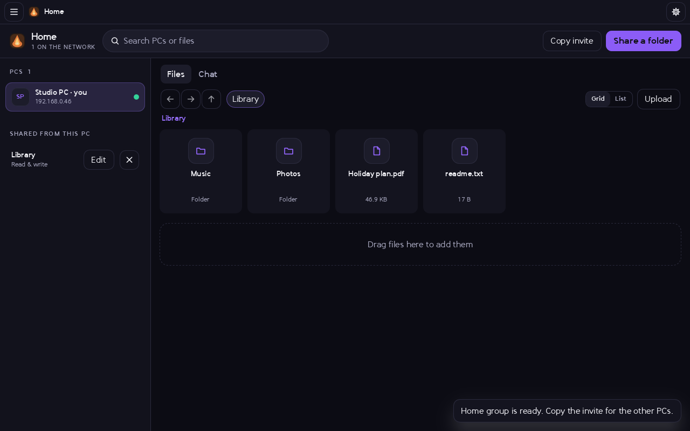
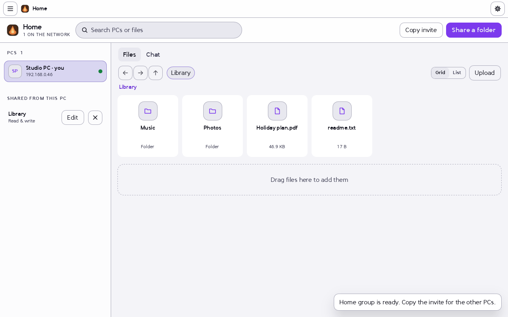

# Hearth

[](https://github.com/AhmiDarrow/Hearth/releases/latest)
[](LICENSE)
[](https://github.com/AhmiDarrow/Hearth/releases/latest)
[](#built-with-remedyui)

**Hearth is one simple home for sharing** — local folder sharing and PC-to-PC chat, with no cloud and almost no setup.

Windows HomeGroup made it boringly easy to share Pictures and Documents across the PCs at home. It disappeared in Windows 10. Hearth brings that ritual back as a modern Windows 11 app: one passphrase, a sidebar of the other computers, drag-and-drop files, and a small house chat. Everything stays on your LAN.

[Download HearthSetup.exe](https://github.com/AhmiDarrow/Hearth/releases/latest/download/HearthSetup.exe) · [All releases](https://github.com/AhmiDarrow/Hearth/releases)

<p align="center">
  <strong>Built with <a href="#built-with-remedyui">RemedyUI</a></strong>: one native Rust program, from the pixels to the peer protocol.
</p>



<p align="center"><em>A shared folder on this PC: the PCs in the house on the left, its files as cards.</em></p>



<p align="center"><em>Themes match RemedyAI. Light mode follows Windows, or pick a palette in Settings.</em></p>

## Built with RemedyUI

Since 1.0, Hearth runs on **RemedyUI**, Ahmi Darrow's own Rust UI engine. The window, the file grid, the tray, text rendering, accessibility, the eleven languages and the signed updater all come from RemedyUI, so the whole app is one native program:

- **No web view, no browser engine, no Python.** The 0.x releases were a Python app that drew a local web page in an Edge WebView2 window; 1.0 replaced all of it. Setup is about 19 MB and installs a single `Hearth.exe`.
- **The same Hearth.** Every screen is what the 0.x app drew, and 1.0 speaks the same protocol and keeps the same profile, so a house can mix 0.3, 0.4 and 1.0 PCs, and updating loses nothing.
- **Same engine as [SecretFolder](https://github.com/AhmiDarrow/SecretFolder)**, [SecretSticky](https://github.com/AhmiDarrow/SecretSticky) and [Alex's Craft Calc](https://github.com/AhmiDarrow/Alexs-Craft-Calc).

RemedyUI is not public yet.

## Features

- One-click Windows installer — no runtime to install, no scripts, no git
- Create a home group or join one already on the LAN with just the password
- Invite codes as a fallback when a second router hides broadcasts
- Share Documents, Pictures, or any folder: **Browse…** opens the Windows folder picker, or type a path, pick a library, or drop a folder on the window
- Edit a share at any time: rename it, **Browse…** to a new folder, switch read-only vs read & write, or unshare (Hearth asks first)
- Browse another PC, download in the background, or drag files onto a writable folder
- Drag files out of Hearth onto the desktop or File Explorer
- Transfers show speed and time remaining; **Clear downloads** (or the × on a finished item) removes completed, failed, and canceled rows without deleting files
- Optional download and upload speed limits in Settings → Transfers (Unlimited by default)
- House chat, stored locally on each PC, with private messages to one PC that is online
- System tray app with its own native window
- Always-visible menu and Settings (General, Sharing, Transfers, Network, Updates, About) with immediate apply and reset to defaults
- RemedyAI color themes in Settings — System, Light, Dark, and the same palettes used in RemedyAI, including Dark Forest
- A choice of typeface in Settings → General → Font: Remedy Sans UI, Remedy Sans, Ahmi Print or Ahmi Pixel
- Eleven languages, switched live in Settings
- Auto-update from GitHub Releases, verified with SHA-256 and the Hearth publisher thumbprint
- Built for homes that have a second router, not only a single subnet

## Download and install

Every home PC needs its own copy.

1. Download **[HearthSetup.exe](https://github.com/AhmiDarrow/Hearth/releases/latest/download/HearthSetup.exe)** from the [latest release](https://github.com/AhmiDarrow/Hearth/releases/latest). No GitHub account is required.
2. Double-click the installer. The build is **self-signed**, so Windows may show SmartScreen or “Unknown publisher.” That is expected until a certificate from a public CA is used. Choose **More info** → **Run anyway** if Windows asks.
3. Click **Install**. The setup is per-user (no administrator prompt) and lands in `%LOCALAPPDATA%\Programs\Hearth`. Leave the defaults checked: desktop shortcut and start at sign-in.
4. Leave **Open Hearth now** checked at the end.

Hearth lives in the system tray. Closing the window hides it; **Quit** from the tray icon exits fully. Open it later from the Start Menu, the desktop shortcut, or the tray. It starts when you sign in.

### Windows Defender and the 0.x builds

Windows Defender has flagged the **0.x** builds as a Trojan more than once (`Trojan:Win32/Bearfoos.A!ml` and similar). Those were **false positives**: a machine-learning verdict against a self-signed app packaged with PyInstaller. A copy that ran fine for weeks can be removed after a Defender definitions update.

**If Defender removed Hearth from your PC, the in-app updater cannot run.** Download [HearthSetup.exe](https://github.com/AhmiDarrow/Hearth/releases/latest/download/HearthSetup.exe) from the latest release and run it. Installing it over what is left of the old copy is fine, and your home group, shares and chat are kept (they live in `%USERPROFILE%\.hearth`, not in the program folder).

Hearth 1.0 is a native program with no PyInstaller in it. Before a release is published, `Hearth.exe` and `HearthSetup.exe` are scanned with Microsoft Defender and the app is run under real-time protection.

## First-run setup

1. This PC’s name is pre-filled from the computer name — change it if you want.
2. On the first PC, click **Start a home group**. Hearth generates a group password (or you can choose one).
3. Install Hearth on the next PC. If the first one is already running on the same LAN, the new PC offers **Join Home on [that PC]**. Type the group password and click **Join**.
4. If the other PC is not detected (a second router often causes this), copy the invite on the first PC (**Copy invite**, or Settings → Network), open **I have an invite** on the second PC, and paste it.
5. Click **Share a folder**, then **Browse…** to pick a folder with the Windows folder picker (you can also type a path, pick a library, or drop a folder onto the window). Click **Share this folder** once to share it.

The menu and the gear in the title bar open **Settings** at any time, including before you join a group. The tray icon has the same items: Open, Settings, Check for updates, About, and Quit.

## Sharing and drag-and-drop

- PCs in the group show up in the left sidebar. Click one to see its shared folders.
- Double-click a folder to open it. Breadcrumbs, Back, and Forward work like File Explorer. Ctrl-click or Shift-click to select more than one file; right-click for Download, Open, Copy path, or Unshare.
- Click **Download** to save selected files to your default download folder (Downloads, unless you change it in Settings → Sharing). Progress, speed, and time remaining appear in the transfer panel. **Clear downloads** (or the × on a finished item) removes completed, failed, and canceled rows from the list — it never deletes the files on disk or stops a transfer that is still running. Optional download and upload speed limits live in Settings → Transfers (Unlimited by default).
- Drop files from Explorer onto a writable share to upload them, or drop a folder onto **Shared from this PC** to share it. You can also drop files onto another PC in the sidebar if that PC has a writable share. Hearth sends files, not folders: open the folder and drop the files inside it.
- Drag a file *out* of Hearth onto the desktop or File Explorer to copy it. Remote files are downloaded first; drag again once the transfer finishes.
- Switch between a grid of cards and a list with the **Grid** / **List** buttons. Hearth remembers which you chose.
- Shares you publish on this PC are listed under **Shared from this PC**. Click **Edit** to rename a share, **Browse…** to a different folder, change read-only vs read & write, or remove it. Changes apply immediately.

## Sub-routers and firewall

Confirm the Wi-Fi or Ethernet is set to a **Private** network (Windows Settings → Network & internet → Properties). A per-user install cannot add firewall rules by itself; if Windows asks, allow Hearth on the Private profile.

| Item | What the installer sets |
| --- | --- |
| Windows Defender Firewall | Not changed by a per-user install (no administrator prompt). On a **Private** network, Windows may ask you to allow TCP **7474** (files and chat) and UDP **45454** (discovery). |
| Autostart | A Startup-folder shortcut starts `Hearth.exe --background` at sign-in (tray only). Upgrades also remove any leftover Run-key entry from older versions. |
| Start Menu and desktop | Shortcuts named **Hearth** |
| Uninstall | Standard Apps & Features / Installed apps entry |

A second router in the house is the usual catch:

| Situation | What to do |
| --- | --- |
| Second box is already an access point (same 192.168.x) | Do nothing. Beacons and the invite handshake find everyone. |
| Second box is a router (for example main 192.168.1.x, rooms 192.168.0.x) | Paste the invite (it includes IPs). The inner PC can usually reach the outer PC. If the outer PC cannot browse the inner PC’s folders, port-forward TCP 7474 and UDP 45454 on the inner router, or put that router in access-point mode. |
| Chat works one way but files from the main LAN cannot open a bedroom PC | Same NAT issue as above. Chat will catch up because members pull messages from PCs they can reach. Folder browse needs a direct connection or a port forward. |
| One PC can ping both sides | Turn on **Bridge discovery across subnets** on that PC (Settings → Network). |
| Windows firewall prompt | Allow Hearth on private networks. Port 7474 TCP and 45454 UDP. |

The most reliable long-term fix is still to set the second router to access-point mode so the house is one LAN. Hearth works either way.

## Trusting the publisher certificate

Each release includes the public certificate `Hearth.cer` and a `SHA256SUMS.txt` file. The release workflow uses the matching private certificate (stored only as GitHub Actions secrets) to Authenticode-sign `Hearth.exe`, the uninstaller, and `HearthSetup.exe`.

Trusting the publisher on a home PC does **not** install a root CA, and it will **not** silence SmartScreen for a brand-new download. It does help Windows recognize later Hearth updates signed with the same certificate, so they should no longer show “Unknown publisher.”

```bat
certutil -user -addstore TrustedPublisher Hearth.cer
```

Or tick **Trust the Hearth publisher certificate** in the installer, or run `trust-hearth-cert.cmd` from the install folder after setup.

## Auto-update

Installed copies check this repository’s [GitHub Releases](https://github.com/AhmiDarrow/Hearth/releases) (including prereleases) shortly after startup and every few hours, and from **Settings → Updates** or **Check for updates** in the app or tray menu.

When a newer version is found, Hearth tells you in a strip at the top of the window. Click **Install update** to download `HearthSetup.exe`, verify it against `SHA256SUMS.txt` and the publisher certificate thumbprint (`C7B807D542B3BA7207AABED960F556B4DC85C02F`), and apply it. The strip shows the download, then “Installing…”. Hearth closes itself, installs in the background with no installer window, and reopens the way it was (window or tray) with your data intact.

If the in-app updater cannot finish (a network error or a signature check that cannot be completed), it does not fail silently: you get a clear message, and the release page opens so you can install by hand.

**Updating from 0.x:** Hearth 0.3.8 and later update themselves to 1.0 the same way. From 0.3.7 or earlier, or if Defender removed your copy, quit Hearth from the tray, download [HearthSetup.exe](https://github.com/AhmiDarrow/Hearth/releases/latest/download/HearthSetup.exe) and run it once by hand.

From a script, `Hearth.exe --install-update` looks for an update now and installs it without asking again, and `Hearth.exe --quit` closes the Hearth that is running.

## Uninstall

Remove Hearth from **Settings → Apps → Installed apps** (or Apps & Features). That removes the program files, Start Menu and desktop shortcuts, autostart entry, and the Private firewall rules.

Data under `%USERPROFILE%\.hearth` (group state, device key, chat history) is left in place so a reinstall can rejoin more easily. Delete that folder if you want a clean slate.

## FAQ and troubleshooting

**Windows blocked the installer / SmartScreen appeared.**  
The official build is self-signed. Choose **More info** → **Run anyway**. See [Trusting the publisher certificate](#trusting-the-publisher-certificate).

**Windows Defender said Hearth is a trojan.**  
That is a false positive against the 0.x builds. If your copy was removed, it cannot update itself: download [the latest release](https://github.com/AhmiDarrow/Hearth/releases/latest) and install it. See [Windows Defender and the 0.x builds](#windows-defender-and-the-0x-builds).

**The other PC does not show up.**  
Make sure both PCs are on a **Private** network, Hearth is running on each (check the tray), and they joined the same group. If there is a second router, paste an invite or use Bridge mode. See [Sub-routers and firewall](#sub-routers-and-firewall).

**I can send chat but I cannot open the other PC’s folders.**  
The other PC is probably behind NAT. Port-forward TCP 7474 and UDP 45454, or set that router to access-point mode.

**A second copy of Hearth opened instead of focusing the first.**  
Hearth only runs once per profile. A second launch (Start menu, shortcut, or an invite passed to it) hands over to the running copy, brings its window to the front (even if it was hidden in the tray), and exits. If a second window still appears, fully **Quit** from the tray and start it again, then please open an issue.

**Can PCs on 0.4 and 1.0 share the same home group?**  
Yes. 1.0 speaks the same protocol as 0.3 and 0.4, so a house can update one PC at a time.

**How do I turn off auto-update?**  
Uncheck **Check for updates automatically** in Settings → Updates, or set `HEARTH_NO_UPDATE=1` for the Hearth process. Installing still requires your click. There is no cloud channel other than GitHub Releases.

**I cannot find Settings or Updates.**  
Open the menu or the gear in the title bar, or right-click the tray icon and choose Settings. Those controls are always shown, including on the first-run screen and in a small window.

**Does this work on macOS or Linux?**  
The released app is for Windows. The engine and the interface also build for Linux from source, but there is no Linux or macOS release.

**Is my data uploaded somewhere?**  
No. Discovery, file transfers, and chat stay on your network. The only outbound check is the optional look at GitHub Releases for updates.

## Building from source

Hearth 1.0 and later is the Rust workspace in `rust/`: `hearth-core` (home groups, discovery, the peer protocol, shares, transfers, chat) and `hearth` (the interface, on RemedyUI). RemedyUI is not public yet, so building needs a checkout of it: `rust/hearth/Cargo.toml` looks for it in a `Projects/RemedyUI` folder beside the folder that holds this repository.

```bash
git clone https://github.com/AhmiDarrow/Hearth.git
cd Hearth/rust
cargo test --workspace
cargo run --release -p hearth
```

Two copies on one machine (for a dry run), each with its own profile and port:

```bash
Hearth.exe --home C:\temp\hearth-a --port 7474
Hearth.exe --home C:\temp\hearth-b --port 7475
```

Join B using A’s invite. If the invite has no loopback address, add `127.0.0.1:7474` as an extra host on B (Settings → Network).

| Path | What it is |
| --- | --- |
| `rust/` | The app (1.0+) |
| `hearth/` | The 0.x Python app. Its language catalogs (`hearth/locales`) and house mark are the ones 1.0 ships, and the Rust tests run 1.0 against it to prove the two still work together |
| `pack/` | Setup (`hearth.iss`), `build-release.ps1`, and the release checks |
| `tests/` | Python tests for the 0.x app and for the release checks (`python -m pytest`) |
| `PORT-CHECKLIST.md`, `port-evidence/` | Everything the 0.x interface did, ticked off against 1.0, with the same screens before and after |

The version lives in one place: `rust/Cargo.toml`. A release is built with `pwsh pack\build-release.ps1 -Upload` (the Rust tests, then the program, uploaded unsigned to a draft release). The **Windows installer** workflow then signs it, builds `HearthSetup.exe`, and installs and updates it for real on GitHub's machines (fresh, over 0.3.8, and 0.3.8, 0.3.15, 0.4.0 and 1.0 updating themselves) before the signed files go on the draft.

State lives in `%USERPROFILE%\.hearth` on Windows (`~/.hearth` on other systems): `state.json`, `device.key`, `inbox/`.

## Security model

- Group password → PBKDF2-HMAC-SHA256 (210k iterations) → 32-byte group key
- Discovery packets and peer HTTP calls carry an HMAC of the group id
- Each install has an Ed25519 device identity under `~/.hearth/device.key`
- Hearth serves the other PCs in the group only: there is no local web page or local API to reach
- This is home-network security, not a substitute for full-disk encryption or a VPN on a hostile LAN
- Do not reuse the hearth password on the public internet

## License

[MIT](LICENSE). Copyright © 2026 Ahmi Darrow.
