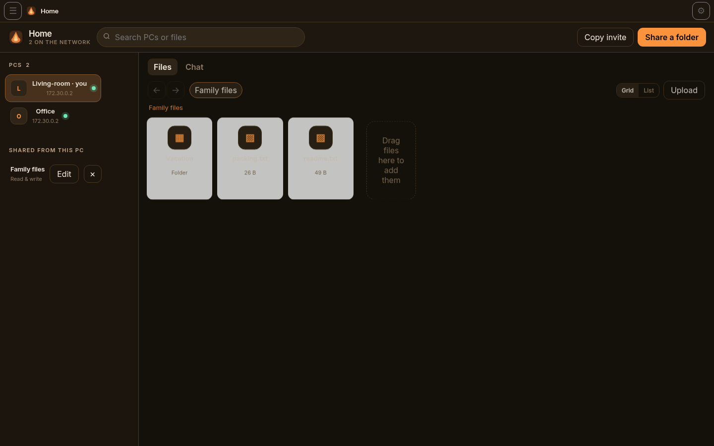
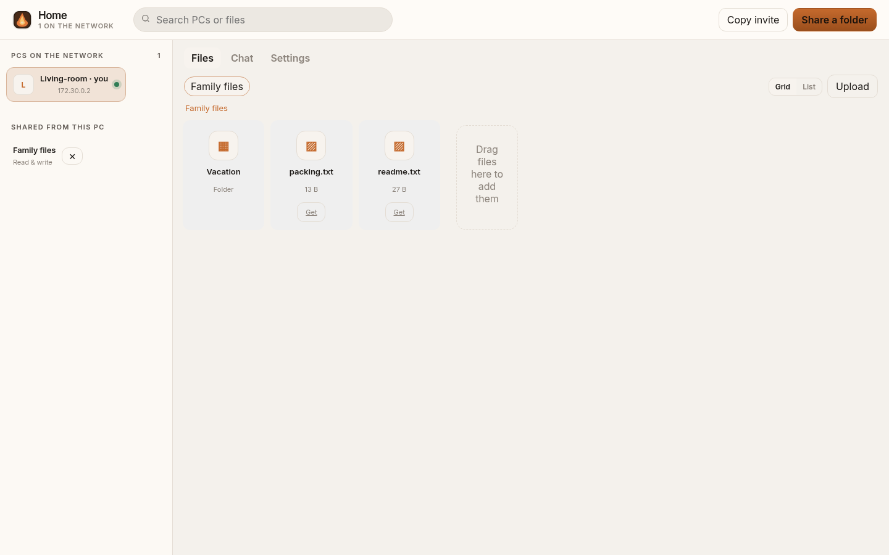

# Hearth

[](https://github.com/AhmiDarrow/Hearth/releases/latest)
[](LICENSE)

**Hearth is one simple home for sharing** — local folder sharing and PC-to-PC chat, with no cloud and almost no setup.

Windows HomeGroup made it boringly easy to share Pictures and Documents across the PCs at home. It disappeared in Windows 10. Hearth brings that ritual back as a modern Windows 11 app: one passphrase, a sidebar of the other computers, drag-and-drop files, and a small house chat. Everything stays on your LAN.

[Download HearthSetup.exe](https://github.com/AhmiDarrow/Hearth/releases/latest/download/HearthSetup.exe) · [All releases](https://github.com/AhmiDarrow/Hearth/releases)



<p align="center"><em>Living-room and Office on the same hearth, browsing a shared folder.</em></p>



<p align="center"><em>Themes match RemedyAI. Light mode follows Windows, or pick a palette in Settings.</em></p>

## Features

- One-click Windows installer — no Python, no scripts, no git
- Create a home group or join one already on the LAN with just the password
- Invite codes as a fallback when a second router hides broadcasts
- Share Documents, Pictures, or any folder: **Browse…** opens the Windows folder picker, or type a path, pick a library, or drop a folder on the window
- Edit a share at any time: rename it, **Browse…** to a new folder, switch read-only vs read & write, or unshare
- Browse another PC, download in the background, or drag files onto a writable folder
- Drag files out of Hearth onto the desktop or File Explorer (Windows)
- Transfers show speed and time remaining; **Clear downloads** (or the × on a finished item) removes completed, failed, and canceled rows without deleting files
- Optional download and upload speed limits in Settings → Transfers (Unlimited by default)
- House chat, stored locally on each PC
- System tray app with an Edge WebView2 window (falls back to the browser)
- Always-visible menu and Settings (General, Sharing, Transfers, Network, Updates, About) with immediate apply and reset to defaults
- RemedyAI color themes in Settings — System, Light, Dark, and the same palettes used in RemedyAI, including Dark Forest
- Auto-update from GitHub Releases, verified with SHA-256 and the Hearth publisher thumbprint
- Built for homes that have a second router, not only a single subnet

## Download and install

Every home PC needs its own copy.

1. Download **[HearthSetup.exe](https://github.com/AhmiDarrow/Hearth/releases/latest/download/HearthSetup.exe)** from the [latest release](https://github.com/AhmiDarrow/Hearth/releases/latest). No GitHub account is required.
2. Double-click the installer. The build is **self-signed**, so Windows may show SmartScreen or “Unknown publisher.” That is expected until a certificate from a public CA is used. Choose **More info** → **Run anyway** if Windows asks.
3. Click **Install**. The setup is per-user (no administrator prompt) and lands in `%LOCALAPPDATA%\Programs\Hearth`. Leave the defaults checked: desktop shortcut and start at sign-in.
4. Leave **Open Hearth now** checked at the end.

Hearth lives in the system tray. Closing the window hides it; **Quit** from the tray icon exits fully. Open it later from the Start Menu, the desktop shortcut, or the tray. It starts when you sign in.

### Windows Defender and earlier builds

Windows Defender flagged some **v0.3.1** and **v0.3.2** installs as a Trojan. That was a **false positive**: a behavioral heuristic against a self-signed PyInstaller app that used a Registry Run key for autostart and could silently launch a downloaded updater. Those releases have been taken down.

**If Defender quarantined Hearth on your PC, the in-app updater cannot run.** Uninstall the old copy (or remove the quarantined files), then install **v0.3.3 or later** from the [latest release](https://github.com/AhmiDarrow/Hearth/releases/latest). Installing the new setup over an older Hearth is fine; it also removes the old Run-key autostart.

Starting with v0.3.3, Hearth is built with a from-source PyInstaller bootloader, a full version resource, Startup-folder autostart instead of a Run key, and a consent-based updater. CI scans both `Hearth.exe` and `HearthSetup.exe` with Microsoft Defender and runs the app under real-time protection before a release is published.

## First-run setup

1. This PC’s name is pre-filled from the computer name — change it if you want.
2. On the first PC, click **Start a home group**. Hearth generates a group password (or you can choose one).
3. Install Hearth on the next PC. If the first one is already running on the same LAN, the new PC offers **Join Home on [that PC]**. Type the group password and click **Join**.
4. If the other PC is not detected (a second router often causes this), open **I have an invite** on the first PC, copy the invite, and paste it on the second PC.
5. Click **Share a folder**, then **Browse…** to pick a folder with the Windows folder picker (you can also type a path, pick a library, or drop a folder onto the window). Click **Share this folder** once to share it.

The hamburger menu and gear in the title bar open **Settings** at any time, including before you join a group. The tray icon has the same items: Open, Settings, Check for updates, About, and Quit.

## Sharing and drag-and-drop

- PCs in the group show up in the left sidebar. Click one to see its shared folders.
- Double-click a folder to open it. Breadcrumbs, Back, and Forward work like File Explorer. Ctrl-click or Shift-click to select more than one file; right-click for Download, Open, Copy path, or Unshare.
- Click **Download** to save selected files to your default download folder (Downloads, unless you change it in Settings → Sharing). Progress, speed, and time remaining appear in the transfer panel. **Clear downloads** (or the × on a finished item) removes completed, failed, and canceled rows from the list — it never deletes the files on disk or stops a transfer that is still running. Optional download and upload speed limits live in Settings → Transfers (Unlimited by default). The window is never replaced by a download page.
- Drop files or folders from Explorer onto a writable share to upload them, or drop a folder onto **Shared from this PC** to share it (when Windows gives Hearth the folder path). You can also drop files onto another PC in the sidebar if that PC has a writable share.
- On Windows, drag a file *out* of Hearth onto the desktop or File Explorer to copy it. Remote files are downloaded first; drag again once the transfer finishes.
- Switch between a Finder-style grid and a list with the **Grid** / **List** buttons.
- Shares you publish on this PC are listed under **Shared from this PC**. Click **Edit** to rename a share, **Browse…** to a different folder, change read-only vs read & write, or remove it. Changes apply immediately.

## Sub-routers and firewall

Confirm the Wi-Fi or Ethernet is set to a **Private** network (Windows Settings → Network & internet → Properties). A per-user install cannot add firewall rules by itself; if Windows asks, allow Hearth on the Private profile.

| Item | What the installer sets |
| --- | --- |
| Windows Defender Firewall | Not changed by a per-user install (no administrator prompt). On a **Private** network, Windows may ask you to allow TCP **7474** (UI, files, chat) and UDP **45454** (discovery). |
| Autostart | A Startup-folder shortcut starts `Hearth.exe --background` at sign-in (tray only). Upgrades also remove any leftover Run-key entry from older versions. |
| Start Menu and desktop | Shortcuts named **Hearth** |
| Uninstall | Standard Apps & Features / Installed apps entry |

A second router in the house is the usual catch:

| Situation | What to do |
| --- | --- |
| Second box is already an access point (same 192.168.x) | Do nothing. Beacons and the invite handshake find everyone. |
| Second box is a router (for example main 192.168.1.x, rooms 192.168.0.x) | Paste the invite (it includes IPs). The inner PC can usually reach the outer PC. If the outer PC cannot browse the inner PC’s folders, port-forward TCP 7474 and UDP 45454 on the inner router, or put that router in access-point mode. |
| Chat works one way but files from the main LAN cannot open a bedroom PC | Same NAT issue as above. Chat will catch up because members pull messages from PCs they can reach. Folder browse needs a direct connection or a port forward. |
| One PC can ping both sides | Turn on **Bridge discovery across subnets** on that PC (Settings). |
| Windows firewall prompt | Allow Hearth on private networks. Port 7474 TCP and 45454 UDP. |

The most reliable long-term fix is still to set the second router to access-point mode so the house is one LAN. Hearth works either way.

## Trusting the publisher certificate

Each release includes the public certificate `Hearth.cer` and a `SHA256SUMS.txt` file. CI uses the matching private certificate (stored only as GitHub Actions secrets) to Authenticode-sign `Hearth.exe`, the uninstaller, and `HearthSetup.exe`.

Trusting the publisher on a home PC does **not** install a root CA, and it will **not** silence SmartScreen for a brand-new download. It does help Windows recognize later Hearth updates signed with the same certificate, so they should no longer show “Unknown publisher.”

```bat
certutil -user -addstore TrustedPublisher Hearth.cer
```

Or tick **Trust the Hearth publisher certificate** in the installer, or run `trust-hearth-cert.cmd` from the install folder after setup.

## Auto-update

Installed copies check this repository’s [GitHub Releases](https://github.com/AhmiDarrow/Hearth/releases) (including prereleases) on startup and every few hours, and from **Settings → Updates** or **Check for updates** in the app or tray menu.

When a newer version is found, Hearth notifies you. Click **Install update** to download `HearthSetup.exe`, verify it against `SHA256SUMS.txt` and the publisher certificate thumbprint (`C7B807D542B3BA7207AABED960F556B4DC85C02F`), and apply it. A small in-app progress bar shows the download, then “Installing…”. Hearth closes itself, runs the official installer fully hidden (`/VERYSILENT`, per-user, no UAC, no installer window), and relaunches in the same window or tray state. Your settings, shares, peers, chat, and downloads are untouched: they live in `%USERPROFILE%\.hearth`, outside the install folder, and the installer never writes there. The certificate is self-signed, so Windows may report the signature as not trusted; Hearth still accepts it when the thumbprint matches and the file hash is intact. Automatic checks only notify — they never install until you click Install update. Automatic checks only run in the packaged Windows app. Set `HEARTH_NO_UPDATE=1` to disable checks (used by tests).

If the in-app updater cannot finish (a network error or a signature check that cannot be completed), it does not fail silently: you get a clear message, and a user-initiated check or Install update opens the [latest release page](https://github.com/AhmiDarrow/Hearth/releases/latest) so you can install by hand.

**Upgrading from v0.3.4:** the updater in v0.3.4 (and the short-lived v0.3.5 / v0.3.6 builds, which are no longer published) cannot read that thumbprint on 64-bit Windows, so in-app Install update will keep being rejected. Quit Hearth from the tray, download [HearthSetup.exe](https://github.com/AhmiDarrow/Hearth/releases/latest/download/HearthSetup.exe), and run the wizard once. Later auto-updates work from v0.3.7 on.

## Uninstall

Remove Hearth from **Settings → Apps → Installed apps** (or Apps & Features). That removes the program files, Start Menu and desktop shortcuts, autostart entry, and the Private firewall rules.

Data under `%USERPROFILE%\.hearth` (group state, device key, chat history) is left in place so a reinstall can rejoin more easily. Delete that folder if you want a clean slate.

## FAQ and troubleshooting

**Windows blocked the installer / SmartScreen appeared.**  
The official build is self-signed. Choose **More info** → **Run anyway**. See [Trusting the publisher certificate](#trusting-the-publisher-certificate).

**Windows Defender said Hearth is a trojan.**  
That happened on some v0.3.1 and v0.3.2 installs (a false positive). Those builds are no longer published. If your copy was quarantined, it will not auto-update — download [the latest release](https://github.com/AhmiDarrow/Hearth/releases/latest) and reinstall. See [Windows Defender and earlier builds](#windows-defender-and-earlier-builds).

**The other PC does not show up.**  
Make sure both PCs are on a **Private** network, Hearth is running on each (check the tray), and they joined the same group. If there is a second router, paste an invite or use Bridge mode. See [Sub-routers and firewall](#sub-routers-and-firewall).

**I can send chat but I cannot open the other PC’s folders.**  
The other PC is probably behind NAT. Port-forward TCP 7474 and UDP 45454, or set that router to access-point mode.

**A second copy of Hearth opened instead of focusing the first.**  
Hearth only runs once per user profile. A second launch (Start menu, shortcut, or a file/URL/invite argument) forwards those arguments to the running copy, brings its window to the front (even if it was hidden in the tray), and exits. If a second window still appears, fully **Quit** from the tray and start it again, then please open an issue.

**In-app update says the installer is not Authenticode-signed, but I downloaded it from this repo.**  
That happened on v0.3.4 (and the withdrawn v0.3.5 / v0.3.6 builds) on 64-bit Windows. Install [the latest release](https://github.com/AhmiDarrow/Hearth/releases/latest) once by hand; from v0.3.7 the updater reads the publisher thumbprint correctly. If a later check cannot finish, Hearth opens the release download page instead of failing silently.

**How do I turn off auto-update?**  
Uncheck **Check for updates automatically** in Settings → Updates, or set `HEARTH_NO_UPDATE=1` for the Hearth process. Install still requires your click. There is no cloud channel other than GitHub Releases.

**I cannot find Settings or Updates.**  
Open the hamburger menu or the gear in the title bar, or right-click the tray icon and choose Settings. Those controls are always shown, including on the first-run screen and in a small window.

**Does this work on macOS or Linux?**  
You can run from source (see below) and use the browser UI. The one-click installer, tray app, and Authenticode updates are Windows-only today.

**Is my data uploaded somewhere?**  
No. Discovery, file transfers, and chat stay on your network. The only outbound check is the optional look at GitHub Releases for updates.

## Building from source

Python 3.11 or newer. The Windows installer is built in GitHub Actions (`windows-latest`) with PyInstaller and Inno Setup; developers can still run the app directly:

```bash
git clone https://github.com/AhmiDarrow/Hearth.git
cd Hearth
python3 -m venv .venv
source .venv/bin/activate   # Windows: .venv\Scripts\activate
pip install -r requirements.txt
python3 -m hearth
```

Open http://127.0.0.1:7474

The `install.cmd` / `install.ps1` scripts are a developer fallback if you want a Start Menu shortcut and firewall rules without the Setup EXE.

Two copies on one machine (for a dry run):

```bash
HEARTH_HOME=/tmp/hearth-a HEARTH_PORT=7474 python3 -m hearth --no-browser
HEARTH_HOME=/tmp/hearth-b HEARTH_PORT=7475 python3 -m hearth --no-browser
```

Join B using A’s invite. If the invite has no loopback address, add `127.0.0.1:7474` as a host on B. The join handshake does not depend on the shared UDP beacon port.

```bash
pip install pytest
python -m pytest
```

The app version lives in one place: `hearth/__init__.py` (`__version__`). The installer and release tag are derived from that string.

State lives in `%USERPROFILE%\.hearth` on Windows (`~/.hearth` on other systems): `state.json`, `device.key`, `inbox/`.

## Security model

- Group password → PBKDF2-HMAC-SHA256 (210k iterations) → 32-byte group key
- Discovery packets and peer HTTP calls carry an HMAC of the group id
- Each install has an Ed25519 device identity under `~/.hearth/device.key`
- This is home-network security, not a substitute for full-disk encryption or a VPN on a hostile LAN
- Do not reuse the hearth password on the public internet

## License

[MIT](LICENSE). Copyright © 2026 Ahmi Darrow.
